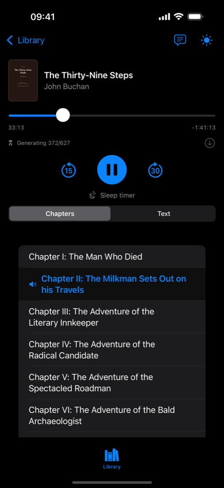
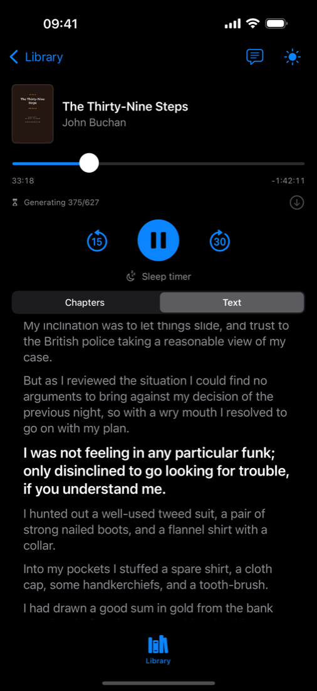
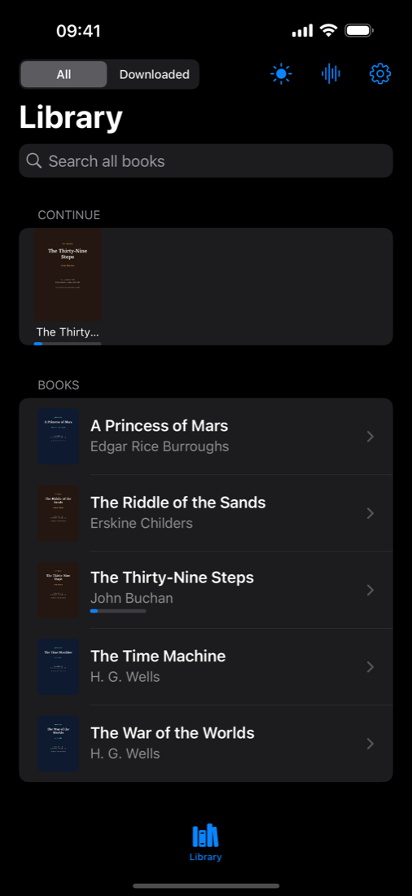

<div align="center">


# KokoroBooks

### Your audiobook starts playing while your Mac is still making it.

A self-hosted audiobook server for your own PDF library, with an iPhone player
that streams the audio as it is generated. No cloud. No account. No upload.

[](#requirements)
[](#how-it-works)
[](ios/README.md)
[](#project-status)
[](LICENSE)

[Website](https://www.mauli.app/kokorobooks/) · [Quick start](#quick-start) · [Sample library](#five-books-to-start-with) · [AI-assisted setup](INSTALL_WITH_AI.md) · [How it works](#how-it-works) · [API](#api-overview) · [Ship the app](docs/APP_STORE.md)

<br>





</div>

---

## The problem

Converting a 400-page book to speech takes hours. Every other tool makes you
wait for all of it before you can hear any of it.

KokoroBooks starts synthesis, pushes finished chunks into a growing HLS stream,
and lets your iPhone start playing once the first segments exist — under a
minute on an M2 Pro with 16 GB.
The Mac keeps working through the book behind you. When it finishes, you get an
M4B with chapter marks for offline listening.

```text
     ┌─────────── you start listening here
     ▼
  ███░░░░░░░░░░░░░░░░░░░░░░░░░░░░░░░░░░░░░  generation continues →
  0:00:45                                    6:41:00
```

## What you get

| | |
|---|---|
| **Your library, not a catalog** | Drop PDFs in a folder on your Mac. Each book is identified by content hash, so renaming or moving it never loses your place. |
| **Listen before it's done** | Chunked synthesis feeds a growing HLS playlist. AVPlayer starts as soon as playable segments exist. |
| **Real chapters** | Chapter marks come from the PDF outline, with front matter, dedications, and copyright pages skipped. |
| **Five Kokoro voices** | Kokoro 82M through MLX on Apple Silicon, at 24 kHz. No voice cloning needed. |
| **Resume anywhere** | Listening position is stored per book on the server and syncs across devices. |
| **Offline when finished** | The completed book is assembled into a tagged M4B with cover art, or downloaded as MP3. |
| **Bounded cache** | Finished audio is kept until a size budget is hit, then the least recently played book is evicted. |
| **Yours alone** | Bearer-token API, meant for your LAN or your Tailscale tailnet. Nothing is uploaded anywhere. |

## Requirements

- **macOS on Apple Silicon** — MLX does not run on Intel.
- **Python 3.11**
- **FFmpeg** — `brew install ffmpeg`
- **An iPhone on iOS 16+** that can reach the Mac, plus Xcode to build the app.
- Network access on first setup to install packages and fetch the Kokoro model.

## Quick start

### 1 · Run the server

```bash
git clone https://github.com/outspokende/kokorobooks.git
cd kokorobooks/backend
python3.11 -m venv .venv
source .venv/bin/activate
pip install -r requirements.txt
mkdir -p ~/Audiobooks/PDFs
```

### 2 · Get five books to listen to

```bash
python -m app.samples
```

This builds a public-domain starter library into
`~/Audiobooks/PDFs/Public Domain Samples/` — about 3 MB, a few seconds, no
books of ours and none of yours. See [the catalog](#five-books-to-start-with).

### 3 · Start it

```bash
python -m app.serve
```

The server prints an API bearer token on startup. Keep it private — it is the
only thing protecting your library.

### 4 · Build the iPhone app

```bash
brew install xcodegen
cd ../ios
xcodegen generate
open KokoroBooks.xcodeproj
```

In Xcode, pick your Apple Developer team, replace the example bundle identifier
`com.example.kokorobooks` with one you own, then build and run on your iPhone.
In the app, enter the server URL (`http://<mac-ip>:8724`) and the token.
Details in [`ios/README.md`](ios/README.md), distribution in
[`docs/APP_STORE.md`](docs/APP_STORE.md).

> **Prefer an AI assistant to do this?** Paste the prompts from
> [INSTALL_WITH_AI.md](INSTALL_WITH_AI.md). They cover installation, the iPhone
> build, your first audiobook, adding a public-domain title, and diagnosing a
> broken setup.

### 5 · Keep it private

Use the Mac and iPhone on the same trusted LAN, or join both to a Tailscale
tailnet. Do not expose the API to the open internet and do not forward a port
to it.

## Five books to start with

KokoroBooks ships no books. `python -m app.samples` builds clean, text-layer
PDFs of five public-domain English novels — three science fiction, two spy
thrillers — directly into your library folder.

| Title | Author | Published | Genre | Approx. runtime |
|---|---|---|---|---|
| **The War of the Worlds** | H. G. Wells | 1898 | Science fiction | ~6.7 h |
| **The Time Machine** | H. G. Wells | 1895 | Science fiction | ~3.6 h |
| **A Princess of Mars** | Edgar Rice Burroughs | 1912 | Science fiction | ~7.2 h |
| **The Thirty-Nine Steps** | John Buchan | 1915 | Spy thriller | ~4.2 h |
| **The Riddle of the Sands** | Erskine Childers | 1903 | Spy thriller | ~11.8 h |

Each is in the public domain in both the United States and the European Union;
the per-title evidence is recorded in [`samples/README.md`](samples/README.md).
*The War of the Worlds* is the same test book used by the related
[Kokoro PDF Audiobook](https://github.com/outspokende/kokoro-pdf-audiobook)
project, so you can compare both pipelines on identical input.

```bash
python -m app.samples --list                  # catalog with rights information
python -m app.samples --only the-time-machine # just one
python -m app.samples --dest ~/Books          # somewhere else
```

*The Thirty-Nine Steps* is the best first conversion: ten chapters, about four
hours, and you will be listening long before it finishes.

## How it works

```text
~/Audiobooks/PDFs
    │
    │  content hash → stable book id
    ▼
PyMuPDF extraction ──> cleaning ──> chapter-aware chunk plan (cached)
    │
    ▼
Supervisor ──> one Kokoro / MLX worker ──> ordered audio chunks
    │                                          │
    ├── FFmpeg HLS muxer <─────────────────────┘
    │       └── growing EVENT playlist ──> iPhone AVPlayer
    │
    └── on completion ──> tagged M4B + cache registration
```

One worker generates at a time, chunk by chunk, with per-chunk timeouts,
retries, and audio sanity checks. The prepared text is cached per book, so
re-converting with a different voice skips extraction entirely.

## API overview

Every call requires the bearer token.

| Method | Path | Purpose |
|---|---|---|
| `GET` | `/api/library` | List books, voices, and cached status |
| `GET` | `/api/library/{book_id}/cover` | Book cover image |
| `POST` | `/api/library/{book_id}/prepare` | Extract and chunk without synthesizing |
| `POST` | `/api/convert` | Start or attach to a conversion |
| `GET` | `/api/jobs/{id}/status` | Job and playback status |
| `GET` | `/api/jobs/{id}/chapters` | Chapter timings |
| `GET` | `/api/jobs/{id}/audio` | Download the completed M4B |
| `GET` | `/api/jobs/{id}/mp3` | Stream the growing or completed MP3 |
| `GET` | `/api/stream/{id}/index.m3u8` | The growing HLS playlist |
| `GET` / `PUT` | `/api/library/{book_id}/progress` | Read or update listening position |
| `GET` | `/api/monitoring` | Service status |

## Configuration

| Variable | Default | Purpose |
|---|---|---|
| `KBS_LIBRARY_DIR` | `~/Audiobooks/PDFs` | Where your PDFs live |
| `KBS_DATA_DIR` | `~/Library/Application Support/KokoroBooks` | State, cache, prepared text |
| `KBS_HOST` / `KBS_PORT` | `0.0.0.0` / `8724` | Listening address |
| `KBS_MODEL` | `mlx-community/Kokoro-82M-bf16` | Kokoro model |
| `KBS_AUDIO_CACHE_GB` | `20` | Cache budget before LRU eviction |
| `KBS_SLEEP_START` / `KBS_SLEEP_END` | `23:55` / `04:00` | Nightly pause so the Mac can sleep |
| `KBS_DEMO` | `0` | Demo mode — see below |
| `KBS_RECAP` | on, off in demo mode | Allow the "previously on…" recap |

### Demo mode

A shared, public server hands its token to everyone, so anything that spends
money or CPU on a stranger's behalf has to be off. `KBS_DEMO=1` disables the
recap feature, which calls a paid third-party API once per request. Browsing,
streaming, chapters, the transcript and downloads all keep working, and
`/api/library` reports `features.recap: false` so the app hides the button
instead of offering something the server will refuse.

There is no upload endpoint anywhere in the API — a book is resolved by content
hash against the server's own library folder — so a demo server can only ever
serve the books you put there yourself.

```bash
KBS_DEMO=1 python -m app.serve
```

### Static catalogue — a demo with no server at all

Once a book is generated, every byte the app needs is a file. Export those
files and any plain web server can host the result; no Python, no Kokoro, no
compute:

```bash
python -m app.catalogue export --dest out/ --voice 1
python -m app.catalogue check --dest out/      # verify a tree before publishing
```

The export writes a `catalogue.json` manifest plus per-book chapters,
transcript, HLS segments and cover. Add `--with-download` to include M4B files.
Every URL inside it is relative, so
the tree works under any domain or subpath. In the app, *Settings → Try the
demo library* points at a hosted catalogue; listening position then stays on
the device, and conversion and recap are not offered because no server exists
to do them.

> Export reads the library that `KBS_LIBRARY_DIR` points at. Point it at the
> public-domain samples before exporting, or you will publish your own books.
> The command prints every title it exports — read that list.

Full first-run checklist in [`SETUP.md`](SETUP.md); running it as a launchd
service is covered in [`deploy/`](deploy).

## Project status

Public beta. PDF extraction, Kokoro synthesis, HLS streaming, authentication,
progress sync, chapter handling, and both download formats have been exercised
on Apple Silicon, including a real conversion through the Kokoro/MLX engine.
The iOS project builds for the simulator; a device build needs your own signing
setup.

The app is not in the App Store yet. The path there — signing, privacy
answers, the questions App Review asks about a self-hosted client, and a
one-command screenshot pipeline — is written up in
[`docs/APP_STORE.md`](docs/APP_STORE.md).

Known scope limits: no offline HLS downloads (the finished M4B is the offline
path), English voices only, and image-only PDFs without a text layer are
rejected rather than run through OCR.

## Privacy and rights

Your PDFs, prepared text, and generated audio stay on your Mac. The iPhone app
talks to exactly one host: the server address you type in. There is no
analytics, no telemetry, and no third-party network call.

Process only material you are allowed to process. KokoroBooks does not bypass
DRM and does not clone voices. The shipped catalog contains public-domain works
only — do not open issues or pull requests containing your own books, audio,
tokens, or library paths.

The source is licensed under [AGPL-3.0](LICENSE), with an
[additional permission for app store distribution](APP_STORE_EXCEPTION.md):
you may ship your own build through the App Store or Google Play as long as the
source stays available. Models and dependencies keep
their own terms: review the
[Kokoro model card](https://huggingface.co/mlx-community/Kokoro-82M-bf16) and
[PyMuPDF licensing](https://pymupdf.io/licensing) before redistributing or
using output commercially.

## Repository map

| Path | What's in it |
|---|---|
| [`backend/`](backend) | API, PDF processing, synthesis, streaming, cache |
| [`backend/app/samples.py`](backend/app/samples.py) | The public-domain sample library builder |
| [`samples/`](samples) | Sample catalog and per-title rights record |
| [`ios/`](ios) | SwiftUI client and playback |
| [`ios/screenshots.sh`](ios/screenshots.sh) | Captures the App Store screenshot set from the running app |
| [`web/`](web) | The mauli.app/kokorobooks landing page and its deploy script |
| [`deploy/`](deploy) | launchd template and installation notes |
| [`docs/APP_STORE.md`](docs/APP_STORE.md) | TestFlight and App Store path for the client |
| [`APP_STORE_EXCEPTION.md`](APP_STORE_EXCEPTION.md) | AGPL additional permission for store distribution |
| [`docs/BRAND.md`](docs/BRAND.md) | App icon, palette, and how to regenerate the icon |
| [`INSTALL_WITH_AI.md`](INSTALL_WITH_AI.md) | Agent prompts for setup, use, and diagnosis |
| [`SETUP.md`](SETUP.md) | Complete first-run checklist |

## Contributing

Bug reports and focused improvements are welcome. Use a public-domain or
synthetic document when reporting a PDF-processing issue, and strip private
paths, tokens, book metadata, and personal information from logs and
screenshots.

```bash
python -m pip install -r backend/requirements-test.txt
cd backend
python -m pytest -q
```

The [backend test workflow](.github/workflows/backend-tests.yml) runs the same
suite on every push and pull request.
