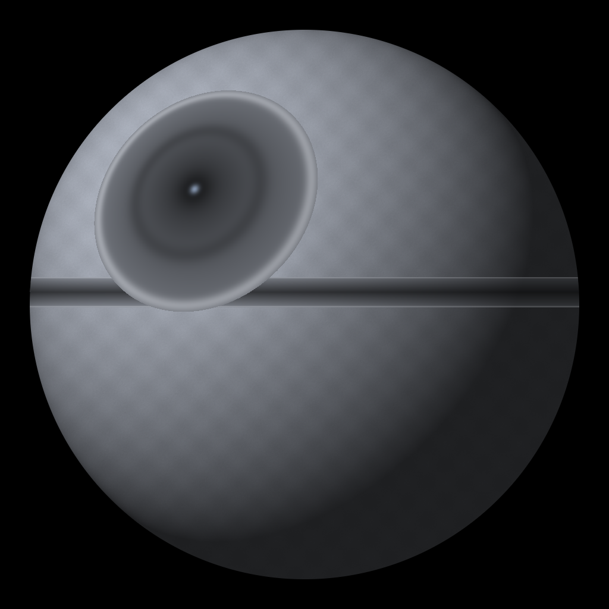

# Brand and app icon

## The icon



A mole wearing headphones behind a stack of books, on deep navy, with mint-teal
sound waves. It is a sibling of the mole used by the
[Mauli](https://www.mauli.app/) audiobook app — same character language, its
own colourway and pose, so the two apps read as a family without looking like
the same product.

| | |
|---|---|
| Master file | [`ios/AudiobookApp/Assets.xcassets/AppIcon.appiconset/icon_1024.png`](../ios/AudiobookApp/Assets.xcassets/AppIcon.appiconset/icon_1024.png) |
| Size | 1024 × 1024, sRGB, **no alpha channel** |
| Shape | Full-bleed square, **no rounded corners** — iOS applies the mask |
| Web copies | [`web/assets/icon-512.png`](../web/assets/icon-512.png), [`icon-180.png`](../web/assets/icon-180.png) |

> **Replaced for a reason.** The previous icon was a grey sphere with a dish on
> it — an unmistakable Death Star. Shipping that would have risked a trademark
> complaint from Lucasfilm and an App Store rejection under the intellectual
> property guideline. Do not bring it back.

## Palette

| Role | Hex | Used for |
|---|---|---|
| Background navy | `#0E1A2F` | The icon field, and the science-fiction sample covers |
| Mint teal | `#5EEAD4` | Sound waves, science-fiction accent |
| Amber | `#E8B059` | Spy-thriller accent on sample covers |
| Spy background | `#241610` | Spy-thriller sample covers |
| iOS blue | `#0A84FF` | The app's interactive tint |

## Regenerating it

The artwork was generated with MiniMax through the `mmx` CLI and then cleaned
up: the model insists on drawing a white border with pre-rounded corners, which
an iOS icon must not have.

```bash
mmx image generate --width 1024 --height 1024 --n 4 \
  --out-dir ./candidates --out-prefix mole --quiet \
  --subject-ref "type=character,image=<path to the Mauli mole>" \
  --prompt "Flat vector app icon in the exact style of the reference character.
The same friendly mole: rounded teardrop body, no visible ears, a long pointed
snout with a small nose, and big digging paws. He wears large over-ear
headphones, eyes closed in a contented smile, rising out of a tidy stack of
three closed books. Background is a solid deep navy blue filling the entire
square right to the edges. Bright teal sound waves arc outward from both
headphone cups. Bold flat shapes, thick confident outlines, no gradients, no
text, no letters. Important: artwork fills the whole square edge to edge, no
white border, no frame, no rounded corners, no drop shadow outside the artwork."
```

Then strip the frame the model added anyway, flatten the background to the
brand navy, and verify the result:

```bash
python backend/scripts/flatten_icon.py docs/brand/icon-source.jpg \
  ios/AudiobookApp/Assets.xcassets/AppIcon.appiconset/icon_1024.png \
  --background "#0E1A2F"
```

The chosen generation is kept at
[`docs/brand/icon-source.jpg`](brand/icon-source.jpg), because image models are
not reproducible — without the source you could never re-cut the icon with a
different background. Running the command above regenerates the shipped file
exactly.

The script fails loudly if the output would keep an alpha channel or if the
four corners are not the same flat colour — the two things App Store Connect
rejects an icon for.

Refresh the web copies afterwards:

```bash
python - <<'PY'
from PIL import Image
src = Image.open("ios/AudiobookApp/Assets.xcassets/AppIcon.appiconset/icon_1024.png").convert("RGB")
for size, name in [(512, "web/assets/icon-512.png"), (180, "web/assets/icon-180.png")]:
    src.resize((size, size), Image.LANCZOS).save(name, optimize=True)
PY
```

### What did not work

- **Asking for green fur directly.** Every attempt drifted into a bear or a
  hamster. The reference-image run produced the only convincing mole.
- **Recolouring the brown fur to Mauli's green afterwards.** The hue shift left
  red speckles along the fur edges and turned the paw tips a dirty orange. If
  you want a green mole, generate it with the character reference rather than
  post-processing this one.
